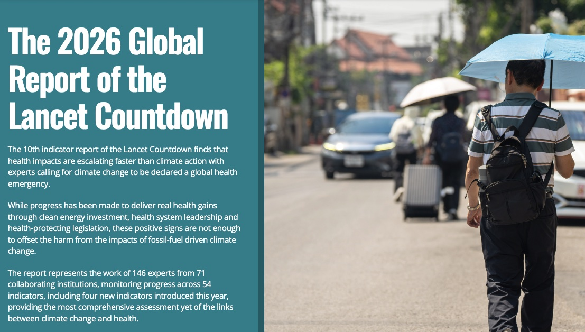
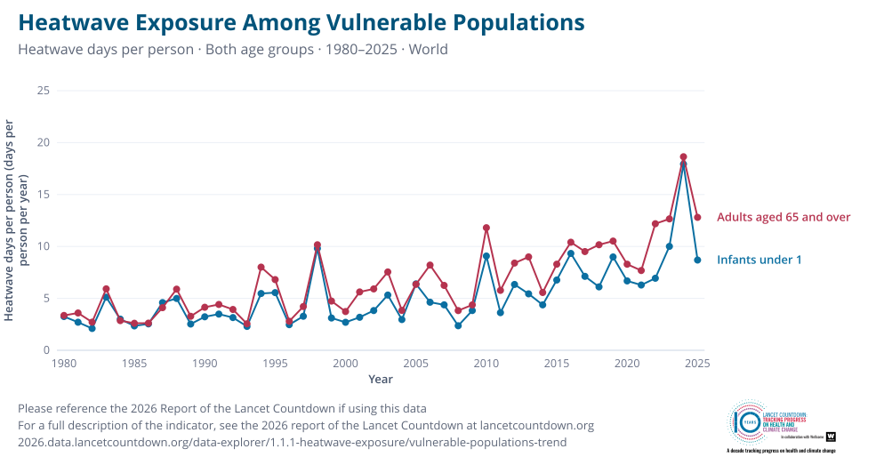

---
tags:
  - research
keywords:
  - climate change
  - heatwaves
  - Lancet Countdown
  - heat exposure
  - older adults
  - infants
  - public health
image: ./img/26-10-global-report-lancet.jpg
description: A summary of the 2026 Global report of the Lancet Countdown, with a focus on heatwave exposure of older adults and infants.
last_update:
  author: Federico Tartarini
---

# The 2026 Report of the Lancet Countdown: A Decade of Escalating Health Harms

The 2026 global report of the *[Lancet Countdown on health and climate change](https://doi.org/10.1016/S0140-6736(26)01779-4)* is out.
It is the tenth report, and it lands ten years after the Paris Agreement entered into force.
This year 146 experts from 71 collaborating institutions tracked 54 indicators, which link climate change to health and measure how well the world is responding.
**The main message is that many health harms of climate change grew faster in 2016–2025 than in the decade before, while climate action has not kept pace.**
For this reason, the authors call for climate change to be formally recognised and addressed as a global health emergency.

 

The 2026 Global Report of the Lancet Countdown

## My Contribution: Exposure of Vulnerable Populations to Heatwaves (Indicator 1.1.1)

Together with Mitchell Black and Ollie Jay, I develop the second part of Indicator 1.1.1.
We track how many heatwave days infants (younger than 1 year) and adults older than 65 years are exposed to, because these two groups are the most vulnerable to heat.
Andrew Pershing and Joseph Giguere lead the first part of the indicator, which estimates how many of those heatwave days are caused by human-induced climate change.
They do this by comparing the observed temperatures with a counterfactual dataset of the temperatures we would have expected without human influence on the climate.

We define a heatwave as a period of at least 3 consecutive days in which both the minimum and maximum temperatures exceed the local 95th percentile of the 1986–2005 baseline.
We then multiply the number of heatwave days in each grid cell by the number of infants and older adults living there.

This year our analysis shows that:

* **Most heatwave days are caused by climate change.** In 2025, each person experienced on average 13.5 heatwave days, and 83% of them (11.3 days) would not have been expected without human-caused climate change.
* **The increase is accelerating.** Heatwave days attributable to climate change increased by 0.74 days per year in 2016–2025, compared with 0.31 days per year in 2006–2015.
* **Older adults face more heatwave days than ever.** Each person older than 65 years experienced on average 11.5 heatwave days per year in 2016–2025, up from 7.2 days in 2006–2015, and 2025 was the second-highest year on record.
* **Infants are also more exposed.** Each infant experienced on average 8.8 heatwave days per year in 2016–2025, up from 5.1 days in 2006–2015.

The figure below shows the average number of heatwave days that each older adult and each infant experienced every year from 1980 to 2025.

 

Heatwave days per person for older adults and infants, 1980–2025 ([interactive version](https://2026.data.lancetcountdown.org/data-explorer/1.1.1-heatwave-exposure/vulnerable-populations-trend?f3.v=1&f3.r=1&f3.view=trend&f3.from=1980&f3.to=2025&f3.geographies=WORLD&f3.measure=days-per-person&f3.band=under-1&f3.representation=line))

You can explore our results by country, region, and Human Development Index group in the new [Lancet Countdown data explorer](https://data.lancetcountdown.org/data-explorer/1.1.1-heatwave-exposure).
For example, this [interactive map](https://2026.data.lancetcountdown.org/data-explorer/1.1.1-heatwave-exposure/vulnerable-populations-exposure?f4.v=1&f4.r=1&f4.view=map&f4.year=2025&f4.band=under-1&f4.baseline=baseline-1986-2005&f4.change-measure=change-total) shows how heatwave exposure of infants in each country changed in 2025 compared with 1986–2005.
The code we used is openly available on [GitHub](https://github.com/Lancet-Countdown/Lancet-Countdown-2026/tree/main/WG1/Indicator%201.1.1.2%3A%20Exposure%20of%20vulnerable%20populations%20to%20heatwaves).

## Broader Highlights from the 2026 Report

The report shows that heatwaves are only one of many health harms that have accelerated over the past decade:

* **Heat-related deaths.** Heat was linked to an average of 540,800 deaths per year between 2016 and 2023, and climate change caused 68% of them. In 2023 alone, heat was linked to a record 710,000 deaths, more than malaria or HIV.
* **Lost work and income.** Heat exposure cost 573 billion potential work hours in 2025, which translates into US$1.07 trillion of lost income. South-East Asia and Africa lost the most, at 3.9% and 3.2% of their GDP.
* **Drought and extreme rainfall.** Extreme drought affected 51.8% of global land for at least one month in 2025, and the affected area grew more than 700% faster in 2016–2025 than in 2006–2015. Very extreme rainfall also became more common, which raises the risk of floods and landslides.
* **Infectious diseases.** A record 1.72 billion people lived within 100 km of coastal waters suitable for *Vibrio* bacteria, and the climate is becoming more suitable for dengue transmission.

## Progress Is Real, but Too Slow

The report also shows that climate action works when it happens.
Clean energy investment reached a record US$2.1 trillion in 2025, and cleaner air now prevents an estimated 323,000 deaths a year in at least 77 countries where fossil-fuel air pollution has fallen since 2016.
56 of 194 WHO member states now have a national plan to adapt health services to climate change, up from 14 in 2015, and health early warning systems are slowing the rise in deaths from extreme weather where they exist.

However, fossil fuels still supply more than 80% of the world's energy, and fossil-fuel air pollution still causes an estimated 2.73 million deaths a year.
The 100 largest oil and gas companies plan to produce 150% more fossil fuels by 2040 than is compatible with limiting warming to 1.5°C.
Developing countries have quantified health adaptation needs of at least US$3.3 billion a year, but only about a third of that (US$1.1 billion) was committed in 2024.

## Moving Forward

Our results for Indicator 1.1.1 show that older adults and infants are facing more heatwave days every year, and that the increase is speeding up.
Because the world's population is also ageing, more people will fall into the most vulnerable group each year.
We therefore need to cut emissions quickly and, at the same time, protect people from the heat that is already locked in.
This means heat-health early warning systems, heat action plans, and low-cost cooling strategies that work for older adults living at home.

## Read the full article:

[Romanello, M., Walawender, M., Israelsson, J., ... Tartarini, F., et al. (2026). The 2026 report of the Lancet Countdown on health and climate change: a decade of escalating health harms and a decisive moment for all. The Lancet.](https://doi.org/10.1016/S0140-6736(26)01779-4)
