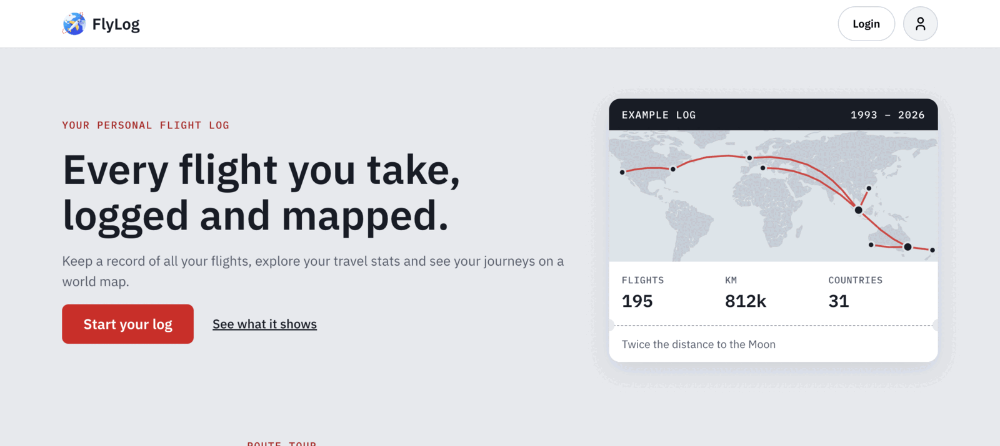
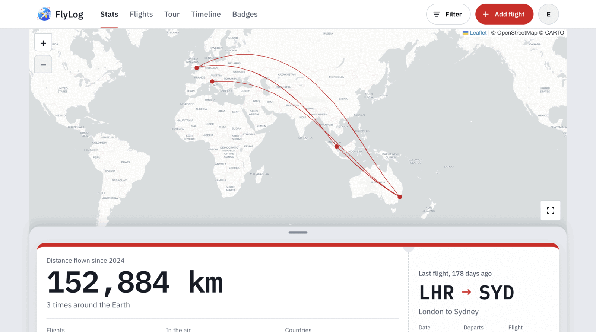
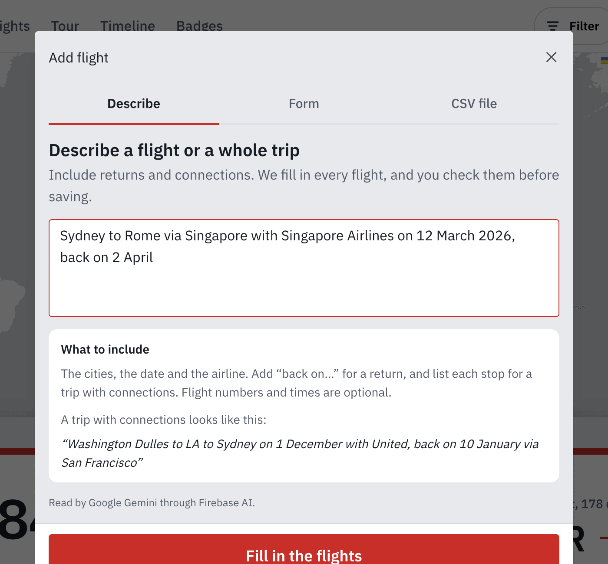
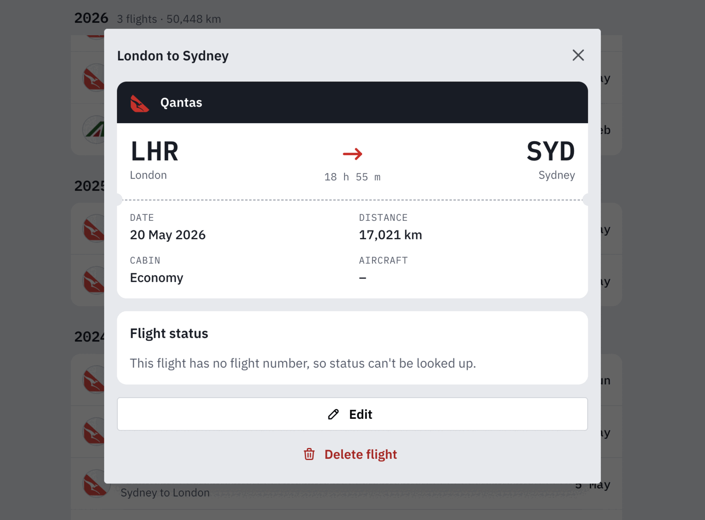
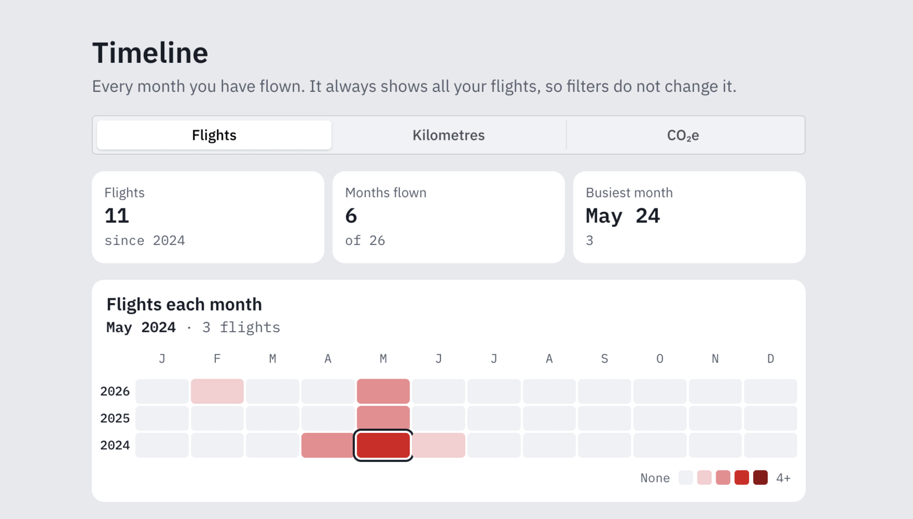
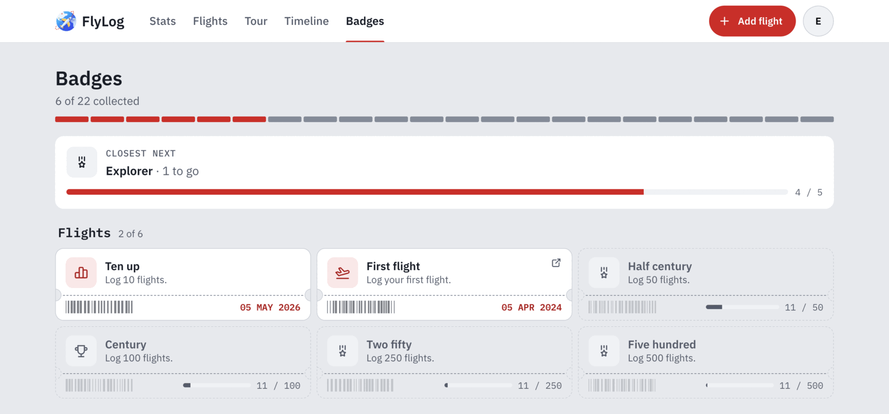
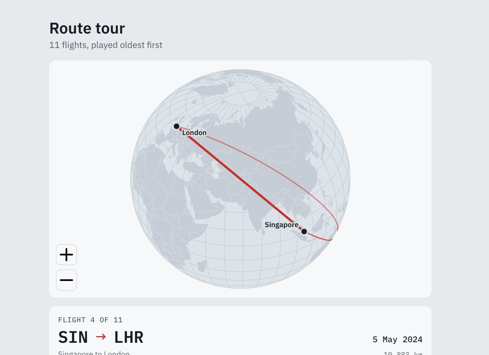

---
tags:
  - tool
  - web application
keywords: 
  - flight log
  - flight tracker
  - travel statistics
  - artificial intelligence
  - open-source
  - firebase
  - map visualization
  - free-to-use
image: ./img/fly-log.png
description: This article describes Fly Log, a free, open-source flight log that maps your journeys, shows your travel statistics and uses AI to add whole trips from a short description.
last_update:
  author: Federico Tartarini
---

# Fly Log

> A free, open-source flight log that maps every journey and turns your travel history into statistics

I love keeping track of my travel statistics and visualizing my routes on a map, but the existing solutions were either too clunky, required manual data entry, or locked my data behind a paywall. 
I got tired of maintaining a boring spreadsheet, so I decided to build my own solution: [Fly Log](https://fly-log.netlify.app/).

:::info

[Fly Log](https://fly-log.netlify.app/) is a free, open-source web application (https://fly-log.netlify.app/) designed to help frequent flyers and aviation enthusiasts visualize their time in the air. 
It works in the browser on a phone or a computer, and you can install it like an app.
You can also view the open-source code base, contribute, or fork the project on [GitHub](https://github.com/FedericoTartarini/fly-log).

:::

In November 2026 I redesigned Fly Log from the ground up. 
It now has a tab bar at the bottom of the screen on phones, a light and a dark appearance, and every flight is drawn as a boarding pass.
The [What's new](https://fly-log.netlify.app/changelog) page lists every change.

## Key Features

**Your stats on a map**: Every flight you log is plotted on a world map, with a line between the departure and arrival airports. 
Under the map, the Stats page shows how far you have flown and how many times that would take you around the Earth, your next or last flight, your longest and shortest flights, and charts of your top airlines, airports and countries.
One filter panel narrows everything down, for example to a single year.

**Add a whole trip by describing it**: The biggest friction point with flight trackers is data entry. Nobody wants to sit down and manually type out IATA airport codes, departure dates, and flight times. 
To solve this, I integrated an AI-powered extraction tool using Google's Gemini model directly into the app. 
You describe your trip the way you would tell a friend, or paste the text from your booking confirmation, and the AI fills in every flight, connections and return included. 
You check the flights before they are saved, so nothing goes in by mistake. 
If you prefer, a form asks for the route first, and you can import many flights at once from a CSV file.

**Every flight, searchable**: The Flights page lists your flights by year. 
You can search by city, airport code, airline or flight number, and sort by date or distance. 
Opening a flight shows it as a boarding pass with its date, distance, cabin and aircraft. 
For upcoming flights with a flight number, Fly Log checks the live status, including delays, the gate and, once the flight has flown, the runway take-off and landing times.

**Timeline and badges**: The Timeline shows every month you have flown as a calendar heatmap, by number of flights, kilometres or CO₂e. 
Badges mark your milestones, from your first flight to flying the distance to the Moon, and a Closest next card shows which one you will earn soonest.

**Replay your journeys**: The Route tour replays your flights on a globe, oldest first. 
The globe turns to each flight and draws its arc, while a boarding pass underneath shows where you are in the tour. 
It plays whatever flights your filters leave, so you can replay a single year, for example.

**Secure and private**: I built Fly Log with privacy in mind. All your flight data is securely stored in a Firebase database, and I have implemented strict access controls to ensure that only you can view and manage your information.

**Free and open-source**: I wanted a tool that worked smoothly without restrictions, so I made Fly Log completely free to use and open-source. 
If you are a developer interested in how to use AI for structured data extraction, the full code is on [GitHub](https://github.com/FedericoTartarini/fly-log).
